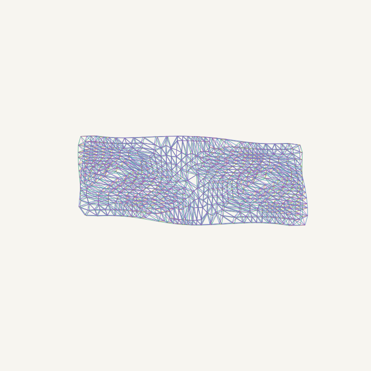

# formgen: Fusion forms to triangulated, tessellated lattices

> **In ACES.** formgen is imported here from `C:\Users\shedm\formgen` (2026-10-06) and is the
> generator behind two ACES manufacturing routes: `robotic_lattice_extrusion` (the lattice is the
> product) and `printed_formwork` (the lattice is foam-filled and finished with sprayed concrete,
> render or coatings). Run it from an ACES spec to get spec validation, route checks and an evidence
> record under CPA:
>
> ```bash
> cp specs/templates/form_lattice.yaml job.yaml     # fill every null
> aces check job.yaml
> aces form job.yaml --out runs/job                 # report.md, run.json, formgen outputs
> ```
>
> The ACES route requires the material density from a named datasheet. formgen's own CLI and Studio
> still default to 1.10 g/cm3 (ABS-CF estimate) and 1.24 g/cm3 filament for scale models; treat
> those as placeholders. A run fails the route if any strut cannot be sequenced or islands stay
> separate. Add a `structure` block to the spec for a static check of the lattice (Pynite).
>
> **This is the copy to develop** (decision D21). The standalone `C:\Users\shedm\formgen` folder is
> kept unchanged for reference and carries a `MOVED_TO_ACES.md` note.



Takes any form out of Autodesk Fusion 360 — **live from the running session** or
from a STEP/STL/OBJ/PLY/3MF/GLB export — and produces a Branch-Technology-style
cellular lattice: a strut/node graph, a printable solid, a buildable print
sequence, robot waypoints, Yaskawa INFORM `.JBI` job stubs for the
HC10DTP + YRC1000micro, and a **desktop-printable scale model STL**.

## Run it now

Inside ACES the launchers live in `tools\windows\`. Run them from the repo root (`C:\Users\shedm\aces`).

**The app**: double-click `tools\windows\formgen-studio.cmd` (or `python -m formgen.studio`).
Pick a file or the live Fusion body, set the lattice, tick *printable scale
model*, press **Run formgen**.

**The terminal**

```bash
tools\windows\formgen.cmd examples\formgen\demo_panel.stl --mode panel --strut 120 --thickness 100 --model --printer x1c
```

**Inside Fusion**: install `fusion_addin\Formgen` as an add-in (below) and press
the *formgen lattice* button in the Solid → Create panel.

First run on a new machine: `tools\windows\install.cmd` builds the repo venv, installs
`requirements-formgen.txt` (verified set, Python 3.11) and installs ACES with the `[formgen]` extra.

## Live Fusion adaptor

`formgen/fusion.py` speaks the Fusion360MCP add-in's socket protocol
(newline-delimited JSON on `127.0.0.1:9876`), so formgen can list the bodies in
your open design, read what you have selected, and export geometry without you
touching a dialog.

```bash
formgen.cmd --list-fusion-bodies                     # what is open right now
formgen.cmd --from-fusion --model --printer x1c      # current selection -> model
formgen.cmd --from-fusion --fusion-body "wing:1/Body3" --mode panel --strut 60
```

Fusion writes STL in millimetres; the adaptor still cross-checks the exported
mesh against the body's API bounding box and corrects a clean unit factor if the
two disagree, so a design authored in inches cannot silently produce a lattice
25.4× too small.

If Fusion or the add-in is not running you get a plain message saying so — the
file path always works regardless.

## Scale models

`--model` scales the lattice onto a build plate and writes a sliceable STL.

```bash
formgen.cmd panel.step --model --printer x1c            # biggest that fits
formgen.cmd panel.step --model --printer a1mini --ratio 25 --base 3
formgen.cmd --list-printers
```

What it handles, and tells you about:

- **auto-fit** picks the largest scale that fits, trying all six axis
  orientations. It never scales a small form *up* unless you pass `--enlarge`.
- **minimum feature size** — a 1:20 model of an 8 mm bead is 0.4 mm, which a
  0.4 mm nozzle cannot make. Struts are clamped to `--min-strut`
  (default 3 × nozzle) and the report states the exaggeration factor, e.g.
  *"struts fattened 1.6× (true 0.76 mm → printable 1.20 mm)"*. The model is
  deliberately not a faithful scale of the bead — know by how much.
- **base plate** — `--base 3` adds a solid slab so a tall panel does not walk
  off the bed.
- **`--model-union`** booleans everything into one watertight solid. Slower, but
  the safest thing to hand a slicer.
- warnings when struts get shorter than ~2.5 × their diameter (nodes blob into
  each other) — that is the signal to use a coarser `--strut` or a bigger scale.

Presets: `x1c p1s a1 a1mini h2d mk4 xl ender3 elegoo sla desk`.

## Outputs per run

| file | purpose |
|---|---|
| `*_lattice.json` | node/strut graph + classified kinds + buildable print order |
| `*_lattice.stl/.glb` | swept strut solids (preview, conventional slicing, FEA) |
| `*_model_1toN.stl/.glb` | **the scale model** — on the plate, z=0, ready to slice |
| `*_preview.png` / `*_model_1toN.png` | three-view contact sheet of the lattice |
| `*_waypoints.csv` | universal approach/start/extrude/detach motion program |
| `*_NNN.JBI` | Yaskawa INFORM Cartesian jobs (validate in MotoSim first) |
| `*_viewer.html` | interactive 3D viewer with print-sequence playback |
| `*_estimate.json` | full report: stats, material kg, print hours, scale-model plan |

## Modes

- **skin** — every triangle edge of the remeshed surface becomes a strut. The
  triangulated tessellated form of the input, one cell thick.
- **panel** — the C-Fab-style default: remeshed outer surface + inward offset
  copy (`--thickness`), vertex-to-vertex ties, and alternating web diagonals →
  a doubly-triangulated space truss you can foam-fill and coat.
- **infill** — experimental interior Delaunay tetra lattice for watertight solids.

## Pipeline internals

1. **load** (`loader.py` / `fusion.py`) STEP is tessellated by OpenCASCADE with
   controllable chord/angle tolerance; live Fusion bodies come through the socket
   bridge. Everything is normalised to millimetres.
2. **remesh** (`remesh.py`) loop-subdivide until dense, then quadric-decimate to
   the face count implied by the target edge length → near-uniform triangles.
   The run warns when thin walls hold the triangles below the target.
3. **tessellate** (`lattice.py`) build the strut graph per mode; nodes
   deduplicated, near-zero-length struts (folded inner skins) dropped and counted.
4. **sequence** (`sequence.py`) FrameFab-lite greedy: a strut prints only from an
   anchored node (platform or printed structure), lowest-top-first. Research-grade
   upgrades: FrameFab (Huang et al., ACM TOG 2016) and Choreo (Huang et al. 2018).
5. **export** (`export.py`, `solids.py`, `viewer.py`, `preview.py`, `scale.py`).

`pipeline.py` is the single entry point all three front-ends call, so the CLI,
the GUI and the Fusion button can never drift apart.

## Fusion add-in

`fusion_addin/Formgen/` is a proper add-in (button + dialog), not a script:

1. Run `tools\windows\install.cmd` once (creates the repo `.venv` the add-in shells out to), then
   `tools\windows\install-fusion-addin.cmd`. It links Fusion's AddIns folder to this checkout with a
   junction, so the add-in always runs the code in the repo.
2. Restart Fusion, or open **UTILITIES → Scripts and Add-Ins** (Shift+S) → **Add-Ins** tab → *Formgen* →
   **Run**. The manifest sets *Run on Startup*.
3. Select a body → **Solid → Create → formgen lattice**

It exports the body itself and shells out to the repo venv, so it does not need
the socket bridge. It finds the project via `FORMGEN_HOME`, its own location (the ACES checkout),
`~/aces`, `~/formgen` (the original standalone folder), or a `formgen_path.txt` beside the add-in.
The package may sit at `<root>/formgen` or `<root>/src/formgen`.

`fusion_addin/FormgenExport.py` is the older plain export script, kept for
batch STEP/STL dumps.

## JBI notes (read before running the cell)

- Jobs are Cartesian (`///POSTYPE USER`, frame `--user-frame`), tool orientation
  fixed nozzle-down (Rx=180). Set your TOOL file (extruder TCP) and user frame
  (build platform) on the pendant first, and **verify every job in MotoSim EG VRC**.
- `V=` values are written as 0.1 mm/s units (`SPEED_SCALE = 10` in `export.py`);
  confirm against your controller settings on first import.
- Extrusion is gated with `DOUT OT#(n)` around each strut; upgrade path is an
  `AOUT` flow command proportional to TCP speed (Macro Command function package)
  or full MotoROS2 streaming from the AGX Orin.
- Jobs auto-split every 250 struts (~1,000 position variables) to stay well under
  controller job-size limits; run in numbered order.

## Repo layout

```
src/formgen/        package
  loader remesh lattice graph sequence solids export viewer   core pipeline
  fusion.py         live Fusion 360 socket adaptor
  scale.py          scale-model planner (printer presets, min feature size)
  preview.py        three-view PNG contact sheet
  pipeline.py       the one shared run() every front-end calls
  cli.py studio.py  terminal and desktop front-ends
fusion_addin/Formgen/       Fusion add-in (button + dialog)
scripts/make_demo_panel.py  2.4 m doubly-curved facade demo panel
examples/formgen/           demo panel
tools/windows/              install.cmd formgen.cmd formgen-studio.cmd launchers
```
