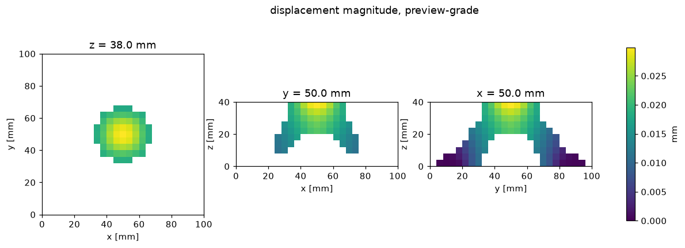

### case v001 · preview-grade

| quantity | value |
|---|---|
| mass_kg | 0.176986 |
| mesh_volume_mm3 | 66286.8 |
| voxel_volume_mm3 | 68224 |
| compliance_Nmm | 828.008 |
| umax_mm | 0.0311983 |
| vm_p99_MPa | 54.4746 |
| vm_p95_MPa | 40.7048 |
| vm_max_MPa | 64.4904 |
| pcg_iters | 221 |
| pcg_relres | 9.90372e-09 |
| elements | 6250 |
| elem_mm | 4 |

Geometry `part.stl`: organic skin (marching cubes of an implicit field), mesh volume 66286.8 mm³; mass 0.176986 kg from the mesh volume. Voxelised at 4 mm into 1066 solid cells of 6250 (voxel/mesh volume 1.0292).

Solve: cpu/numpy float64 on lane desktop-cpu, 221 PCG iterations, true relative residual 9.90e-09, converged. Constrained stress is vm_p99 over the solid elements outside the boundary-condition zones (+-8 mm); vm_max is recorded but is resolution-sensitive.

preview-grade: a desktop voxel solve is evidence, not sign-off.

