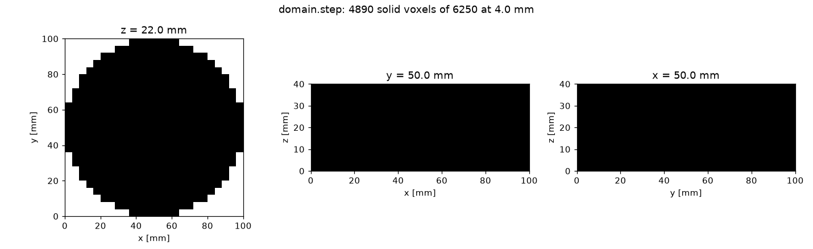
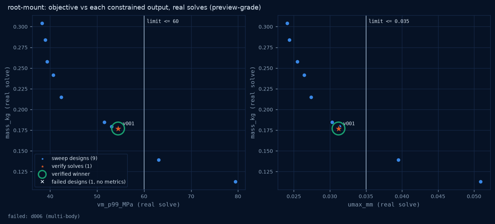
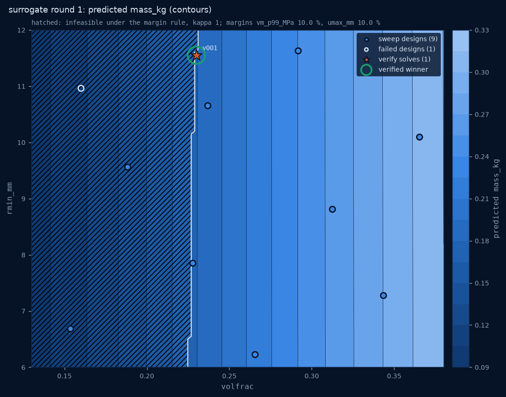
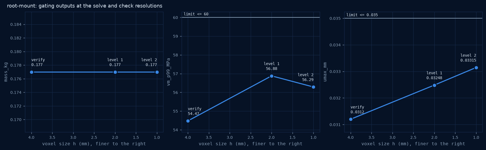
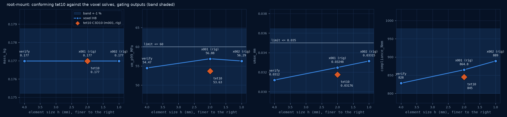
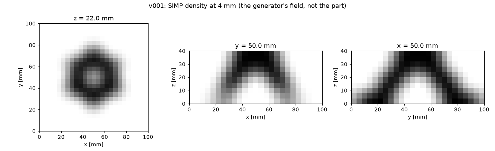
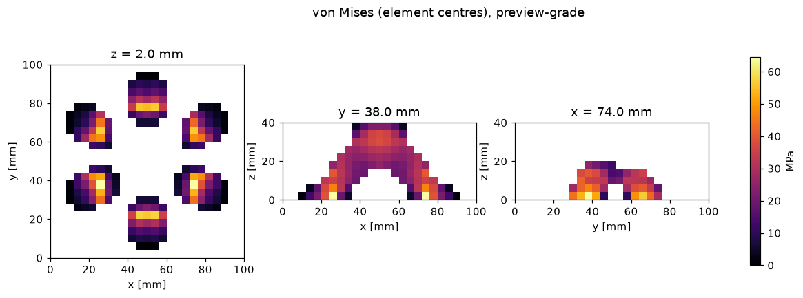

# aces golden: root-mount (20261010T084920Z-b3ac99)

**PASS · rig-verified · root-mount: volfrac 0.23 rmin_mm 11.55 · mass 0.177 kg · vm_p99_MPa 54.47 <= 60 · umax_mm 0.0312 <= 0.035 · predicted within 10 % (max 1.527 % on vm_p99_MPa) · check 2 mm on the rig (GPU 0): max gap +4.414 % on vm_p99_MPa, constraints met · conforming tet10 2 mm (ccx 2.23, rig): max gap -4.95 % on compliance_Nmm, constraints met · bundle 91aaf1ad1877 simlab #3 · aces #4 · stages 82.7 s**

Project `golden-demo` · run directory `/home/aces/Work/golden-demo/golden/20261010T084920Z-b3ac99` · created 2026-10-10T08:49:20.069+00:00 · demo `root-mount` (demo inputs)

Six-foot root mount computed inside a disc design space 100 mm across and 40 mm tall: six bolted feet on a 36 mm ring and a 30 kN load on a top cup. The disc is only the input domain; the part is computed (SIMP topology optimisation, organic implicit skin) and solved on the real voxel FEA. Demo inputs.

## 1. Key numbers

Case `v001` (vm_max is resolution-sensitive and never constrained).

| quantity | value |
|---|---|
| mass_kg | 0.177 |
| mesh_volume_mm3 | 66290 |
| mass_voxel_kg | 0.1822 |
| voxel_volume_mm3 | 68220 |
| compliance_Nmm | 828 |
| umax_mm | 0.0312 |
| vm_p99_MPa | 54.47 |
| vm_p95_MPa | 40.7 |
| vm_max_MPa | 64.49 |
| pcg_iters | 221 |
| constraint vm_p99_MPa <= 60 | 54.47 (met) |
| constraint umax_mm <= 0.035 | 0.0312 (met) |
| designs finished | 9 of 10 |
| grade | rig-verified |

## 2. Inputs and provenance

- spec `inputs/spec.json` sha256 `b6c8bbefb1e9df1305ca900f598903a007b07b387751c93b4f90c30ba936ef94` (demo root-mount); effective spec sha256 `acc99c6a2671265e41521b81d1ce216ba0c61d4f3759665286e456c317045b52`
- overrides: none
- design space: build123d `aces_engineering.golden.demo:root_mount_domain` -> `inputs/domain.step` sha256 `2494aed7db9a36629d6d498482afe4eb3569b47876c718eb97d8b3d45899bcef` (B-rep volume 314200 mm3)
- the STEP header carries an export timestamp, so step_sha256 changes per export; the stable geometry digest is domain.json mask_sha256
- voxel mask sha256 `b4689f1bfef6263a63956bfd2247db3c7ea7dbce0a668c8f99a0d3751bd20434`; seed 7

| material | E (MPa) | nu | density (kg/mm3) | allowable vm (MPa) |
|---|---|---|---|---|
| AlSi10Mg (LPBF), nominal | 70000 | 0.33 | 2.67e-06 | 60 |

Material source: Nominal handbook values for AlSi10Mg: E 70 GPa, Poisson 0.33, density 2.67 g/cm3. The 60 MPa allowable is a demo design limit chosen so the stress constraint is active; it is not a material strength. Demo inputs, not a qualified material card.

| kind | name | box (mm, part frame) | detail |
|---|---|---|---|
| support | foot-1 | 76, 64, 0, 88, 76, 0 | dofs [0, 1, 2] |
| support | foot-2 | 44, 80, 0, 56, 92, 0 | dofs [0, 1, 2] |
| support | foot-3 | 12, 64, 0, 24, 76, 0 | dofs [0, 1, 2] |
| support | foot-4 | 12, 28, 0, 24, 40, 0 | dofs [0, 1, 2] |
| support | foot-5 | 44, 8, 0, 56, 20, 0 | dofs [0, 1, 2] |
| support | foot-6 | 76, 28, 0, 88, 40, 0 | dofs [0, 1, 2] |
| load | cup-down | 40, 40, 40, 60, 60, 40 | force [0.0, 0.0, -30000.0] N, axis z, case down |

| region | name | shape (mm) | round (mm) |
|---|---|---|---|
| keep-in | foot-1 | cylinder z, centre (82, 70), r 9, span 0..6 | 1 |
| keep-in | foot-2 | cylinder z, centre (50, 86), r 9, span 0..6 | 1 |
| keep-in | foot-3 | cylinder z, centre (18, 70), r 9, span 0..6 | 1 |
| keep-in | foot-4 | cylinder z, centre (18, 34), r 9, span 0..6 | 1 |
| keep-in | foot-5 | cylinder z, centre (50, 14), r 9, span 0..6 | 1 |
| keep-in | foot-6 | cylinder z, centre (82, 34), r 9, span 0..6 | 1 |
| keep-in | cup | cylinder z, centre (50, 50), r 15, span 34..40 | 1 |

- resolutions (mm): generator 4, skin field 2, solve 4, check levels 1: 2
- grid: origin [0.0, 0.0, 0.0] mm, envelope [100.0, 100.0, 40.0] mm
- stress-exclusion zones (vm_p99 ignores them): 7 boxes, 8 mm (the spec asks 6 mm: rounded up to the 4 mm lattice, so every solve resolution excludes the same zone)
- objective min mass_kg; constraints vm_p99_MPa <= 60, umax_mm <= 0.035
- design variables: volfrac [0.13, 0.38], rmin_mm [6, 12]; fixed: penal 3
- solver digest: vendored snapshot 62de9811e555 content sha256 `da7c28a37dabbe8ba55e1817d668c734a4cf951da15740d1e9f837d611ed8ac9`; imported modules match the snapshot: True; golden code sha256 `580a72d7e96b3dc64a0c74b7161a51f5a07a8f582188d8044ee9f0e2a56d7363`
- hypothesis: A SIMP-generated organic root mount meets vm_p99 <= 60 MPa and umax <= 0.035 mm at minimum mass, and a GP surrogate fitted to a 10-design sweep predicts the verified winner within 10 %.
- demo inputs: the material, the allowable and the loads are demonstration values, not a qualified design case

## 3. Design-space voxelisation

step-structures stage_mesh at 4 mm: 6250 cells, 4890 inside the design space (design share 0.7824), voxel/B-rep volume 0.9962, watertight tessellation True; 136 passive void boxes keep the generator inside the design space.

## 4. Compute used

| step | computation | solver | device | resolution (mm) | size | count | wall s | sum s | grade | note |
|---|---|---|---|---|---|---|---|---|---|---|
| kernel | element and patch tests | gendesign.fea3d.self_test | cpu | 1 | 10x2x2 bar (40 elements) | 1 | 0.0021 | 0.0021 | - | element checks and the uniaxial bar: passed |
| domain | STEP -> voxel mask | step-structures stage_mesh (Embree containment) | cpu | 4 | 6250 cells, 4890 solid | 1 | 0.464 | 0.0168 | - | voxel/B-rep volume 0.9962; watertight tessellation True; wall_s is the whole domain step (passive boxes, design-space SDF), wall_s_sum the stage_mesh records |
| generate | SIMP x 11 | gendesign.topopt3d.run_case (OC, FFT filter) | cpu/numpy x4 | 4 | 6250 elements | 11 | - | 23.8 | - | 10 sweep and 1 verify designs; the 10 sweep designs ran concurrently in 4 workers, wall_s_sum is the sum over designs |
| skin | organic skin x 11 | golden.organic (EDT SDF, smooth unions, Taubin) | cpu | 2 | 50000 field points | 11 | - | 0.391 | - | 10 of 11 watertight single-body skins; median 10660 faces |
| solve | real FEA x 9 | step-structures stage_solve, Jacobi-PCG FP64 | cpu/numpy x4 | 4 | 6250 elements, 22308 DOF | 9 | - | 1.67 | preview-grade | 9 of 9 converged; ran concurrently in 4 workers |
| surrogate | GP K-fold per round | simlab.surrogate.tabular (gp) | cpu | - | n=9 | 1 | 1.08 | 1.08 | - | round 1: weak, max CV MAPE 4.96 % on vm_p99_MPa, 31 GP warnings |
| optimise | grid per round | golden.optimise | cpu | - | 1681 candidates | 1 | 0.0061 | 0.0061 | - | round 1: 1022 predicted feasible |
| verify | real FEA x 1 | step-structures stage_solve, Jacobi-PCG FP64 | cpu/numpy | 4 | 6250 elements, 22308 DOF | 1 | 0.162 | 0.162 | preview-grade | round 1 v001: PASS |
| check | finer real FEA, level 1 | golden-check on the rig (step-structures stage_solve, pcg FP64) | rig gpu 0 (NVIDIA CMP 170HX) | 2 | 50000 elements, 163863 DOF | 1 | 1.03 | 1.03 | independent check -> verified-desktop | job golden-20261010T084920Z-b3ac99-check--c000--run--5b7df8; image sha256:d45698807541; lease wait 1.62 s |
| check | finer real FEA, level 2 | golden-check on the rig (step-structures stage_solve, mg FP64) | rig gpu 2 (NVIDIA CMP 170HX) | 1 | 400000 elements, 1254723 DOF | 1 | 6.34 | 6.34 | informational (agrees) | job golden-20261010T084920Z-b3ac99-check--c001--run--a53d84; image sha256:d45698807541; lease wait 1.77 s |
| parity | CuPy / Warp re-solve | step-structures stage_solve / WarpApplyK | - | - | - | 0 | - | - | - | not run: no device parity: no usable GPU (CuPy is not importable here (an optional extra; the packaged venv does not ship it)) |
| rig | experiment golden-20261010T084920Z-b3ac99-check: check, 2 case(s) | golden-check (aces-golden:0.1) | rig gpu 0,2 | - | - | 2 | 18.7 | 11 | used | principal anonymous; max queue wait 1.77 s |
| rig | experiment golden-20261010T084920Z-b3ac99-conf: conf, 1 case(s) | ccx-check (aces-golden:0.1) | rig cpu | - | - | 1 | 65.8 | 54.4 | used | principal anonymous; max queue wait 1.98 s |
| warp-lattice | rod-lattice generator | gendesign.lattice_opt | - | - | - | 0 | - | - | not used | not used: cantilever demonstrator, not wired into the golden path (v0) |
| fno | field surrogate | simlab.surrogate.fno (torch, PhysicsNeMo) | - | - | - | 0 | - | - | not used | not installed (torch, PhysicsNeMo); a field (FNO) surrogate needs O(100) solved fields; v0 fits a tabular GP |
| second-discretisation | conforming tet10 (C3D10) at 2 mm | gmsh 4.15.2 + CalculiX ccx 2.23 | rig cpu x16 | 2 | 38618 C3D10, 187011 DOF | 1 | 54.3 | 54.3 | second discretisation -> agrees |  |

## 5. Generative sweep

10 designs from a Latin hypercube (random-cd, seed 7) over volfrac [0.13, 0.38], rmin_mm [6, 12]; 9 finished. Every design is generated (SIMP), skinned (organic implicit surface) and solved on the real voxel FEA; all are preview-grade.

| case_id | status | volfrac | rmin_mm | mass_kg | umax_mm | vm_p99_MPa | vm_max_MPa | compliance_Nmm | pcg_iters | faces | genus |
|---|---|---|---|---|---|---|---|---|---|---|---|
| d000 | FINISHED | 0.1881 | 9.568 | 0.139 | 0.0395 | 63.08 | 74.66 | 1062 | 262 | 10020 | 0 |
| d001 | FINISHED | 0.2368 | 10.65 | 0.1846 | 0.03031 | 51.57 | 60.52 | 800.6 | 218 | 10472 | 0 |
| d002 | FINISHED | 0.3433 | 7.279 | 0.284 | 0.02439 | 39 | 41.78 | 621 | 202 | 11248 | 0 |
| d003 | FINISHED | 0.3652 | 10.1 | 0.3043 | 0.02409 | 38.27 | 41.03 | 612.7 | 201 | 10952 | 0 |
| d004 | FINISHED | 0.1535 | 6.688 | 0.1128 | 0.05092 | 79.45 | 83.38 | 1365 | 288 | 9596 | 0 |
| d005 | FINISHED | 0.2278 | 7.858 | 0.1795 | 0.0313 | 53.1 | 57.79 | 825.1 | 225 | 10660 | 0 |
| d006 | FAILED | 0.1601 | 10.96 | - | - | - | - | - | - | 8364 | 0 |
| d007 | FINISHED | 0.2915 | 11.63 | 0.2417 | 0.02644 | 40.65 | 49.69 | 684.3 | 183 | 10628 | 0 |
| d008 | FINISHED | 0.2655 | 6.233 | 0.2148 | 0.02736 | 42.4 | 50.38 | 707.9 | 218 | 10968 | 0 |
| d009 | FINISHED | 0.3125 | 8.814 | 0.2577 | 0.02548 | 39.36 | 45.96 | 653.5 | 208 | 11100 | 0 |

Failed designs:

- d006: multi-body (the skin has 3 solid bodies; a part is one body)

sweep.csv sha256 `9a5961e5d90936f3e0c6dec8178343e705e61ce3808ab8dfb1fd832aa2c53814`

## 6. Surrogate

Round 1: gp on 9 real solves, 5-fold CV; log outputs auto-positive -> always; status **weak** (vm_p99_MPa R2 0.828 < 0.9); 31 GP warnings captured; model sha256 `0a4c39eff2e379f8747f2ae1d9d9f54e7edd79835f7843c71a0f763aa839c7a8`

| output | RMSE | MAE | MAPE % | R2 | log | range |
|---|---|---|---|---|---|---|
| mass_kg | 0.002763 | 0.002379 | 1.093 | 0.998 | yes | 0.1128, 0.3043 |
| vm_p99_MPa | 5.467 | 3.136 | 4.958 | 0.8283 | yes | 38.27, 79.45 |
| umax_mm | 0.0004734 | 0.000246 | 0.6233 | 0.9968 | yes | 0.02409, 0.05092 |
| compliance_Nmm | 3.674 | 2.309 | 0.2583 | 0.9998 | yes | 612.7, 1365 |
| vm_max_MPa | 2.241 | 1.59 | 2.668 | 0.9737 | yes | 41.03, 83.38 |

## 7. Optimisation

Round 1: grid over 1681 candidates (0 within 0.02 of a verified design excluded: none); kappa 1, margins vm_p99_MPa 10 %, umax_mm 10 %; 1022 predicted feasible.

winner: volfrac 0.23, rmin_mm 11.55 -> mass_kg 0.1794 +- 0.002114, vm_p99_MPa 53.64 +- 0.3258, umax_mm 0.03126 +- 2.73e-05, compliance_Nmm 829.6 +- 0.7083, vm_max_MPa 62.56 +- 1.457

| volfrac | rmin_mm | mass_kg | vm_p99_MPa | umax_mm | compliance_Nmm | vm_max_MPa |
|---|---|---|---|---|---|---|
| 0.23 | 11.55 | 0.1794 | 53.64 | 0.03126 | 829.6 | 62.56 |
| 0.23 | 11.4 | 0.1794 | 53.6 | 0.03125 | 829 | 62.4 |
| 0.23 | 11.25 | 0.1794 | 53.55 | 0.03124 | 828.5 | 62.24 |
| 0.23 | 11.1 | 0.1794 | 53.51 | 0.03123 | 827.9 | 62.09 |
| 0.23 | 10.95 | 0.1794 | 53.46 | 0.03121 | 827.4 | 61.93 |

## 8. Verification

Resolutions recorded in the validation record (mm): generator 4, field 2, solve 4, check 2, 1. Tolerance 10 %, kappa 1.

Round 1: `v001` (from the feasible set, cpu, step-structures stage_solve) -> **PASS**

| output | role | predicted | sd | solved | rel err | agree | limit | meets |
|---|---|---|---|---|---|---|---|---|
| mass_kg | objective | 0.1794 | 0.002114 | 0.177 | 1.375 % | yes | - | - |
| vm_p99_MPa | constraint | 53.64 | 0.3258 | 54.47 | 1.527 % | yes | <= 60 | yes |
| umax_mm | constraint | 0.03126 | 2.73e-05 | 0.0312 | 0.192 % | yes | <= 0.035 | yes |
| compliance_Nmm | reported | 829.6 | 0.7083 | 828 | 0.1876 % | yes | - | - |
| vm_max_MPa | reported | 62.56 | 1.457 | 64.49 | 2.996 % | yes | - | - |

## 9. Independent check and device parity

| level | case | h (mm) | device | host | gating | estimate s | budget s | ran | passed | reason |
|---|---|---|---|---|---|---|---|---|---|---|
| 1 | x001 | 2 | rig | rig | yes | - | 60 | yes | yes | finer check on the rig (golden-check through lane sim/pool) |
| 2 | x002 | 1 | rig | rig | no | - | 60 | yes | yes | extra level on the rig (golden-check through lane sim/pool) |

Level 1 (2 mm):

| output | role | coarse | fine | gap | agree | limit | meets at fine h |
|---|---|---|---|---|---|---|---|
| mass_kg | objective | 0.177 | 0.177 | +0 % | yes | - | - |
| vm_p99_MPa | constraint | 54.47 | 56.88 | +4.414 % | yes | <= 60 | yes |
| umax_mm | constraint | 0.0312 | 0.03248 | +4.118 % | yes | <= 0.035 | yes |
| compliance_Nmm | reported | 828 | 864.8 | +4.449 % | yes | - | - |
| mass_voxel_kg | reported | 0.1822 | 0.1793 | -1.571 % | yes | - | - |
| vm_max_MPa | reported | 64.49 | 105.4 | +63.42 % | no | - | - |

Level 2 (1 mm):

| output | role | coarse | fine | gap | agree | limit | meets at fine h |
|---|---|---|---|---|---|---|---|
| mass_kg | objective | 0.177 | 0.177 | +0 % | yes | - | - |
| vm_p99_MPa | constraint | 54.47 | 56.29 | +3.327 % | yes | <= 60 | yes |
| umax_mm | constraint | 0.0312 | 0.03315 | +6.242 % | yes | <= 0.035 | yes |
| compliance_Nmm | reported | 828 | 889 | +7.361 % | yes | - | - |
| mass_voxel_kg | reported | 0.1822 | 0.1774 | -2.587 % | yes | - | - |
| vm_max_MPa | reported | 64.49 | 178.4 | +176.6 % | no | - | - |

Device parity: not run: no device parity: no usable GPU (CuPy is not importable here (an optional extra; the packaged venv does not ship it)).

Grade **rig-verified**: the 2 mm check agrees with the 4 mm solve within 10 % and meets every constraint, solved on the rig; the conforming tet10 second discretisation (m001, 2 mm, rig) agrees within its bands and meets every constraint

Scope: voxel FEA (H8, fictitious domain, Jacobi-PCG or multigrid-PCG, FP64, linear static) on this desktop or on a rig lane, with a conforming tet10 (C3D10, gmsh + CalculiX ccx) second discretisation when it can run. Grades: preview-grade (every solve on its own), verified-desktop (the finer-resolution level-1 check agrees within tol and meets every constraint), rig-verified (also: the level-1 check solved on the rig on an image the golden-check validation names, the conforming check ran on the rig on an image the ccx-check validation names and agrees within its bands and meets every constraint, the rig ran this desktop's golden code, and every pulled file verified). A conforming check that violates a constraint caps the grade at preview-grade. No grade is a sign-off.

## 10. Conforming second discretisation

Case `m001` on the rig (mode `auto`), the part of `v001`: gmsh 4.15.2 C3D10 (straight-sided tet10) at 2 mm, discrete route (Algorithm3D 1): 38618 elements, 62337 nodes, 187011 DOF; minimum SICN 0.3383 (1st percentile 0.578); mesh volume 66290 mm3 (+2.195e-14 % against the STL).

Boundary conditions on the mesh surface (window 2 mm, faces facing within 45 degrees of the plane normal):

| kind | name | mode | faces | nodes | area (mm2) | projected (mm2) | footprint (mm2) | coverage | plane offset (mm) |
|---|---|---|---|---|---|---|---|---|---|
| support | foot-1 | surface | 74 | 193 | 147 | 146.6 | 144 | 1.018 | 0.3491 |
| support | foot-2 | surface | 73 | 192 | 146 | 145.8 | 144 | 1.012 | 0.3062 |
| support | foot-3 | surface | 73 | 192 | 145.9 | 145.5 | 144 | 1.011 | 0.3312 |
| support | foot-4 | surface | 73 | 192 | 145.6 | 145.3 | 144 | 1.009 | 0.3473 |
| support | foot-5 | surface | 73 | 192 | 146 | 145.8 | 144 | 1.012 | 0.3044 |
| support | foot-6 | surface | 73 | 192 | 145.8 | 145.5 | 144 | 1.01 | 0.3344 |
| load | cup-down | traction | 200 | 339 | 400.6 | 400.6 | 400 | 1.001 | 0.01568 |

Solver: CalculiX ccx 2.23 (Factoring the system of equations using the symmetric spooles solver), 16 threads; mesh 10.04 s, solve 39.85 s, post 3.434 s. Equilibrium: applied [0, 0, -30000] N, reactions [0.000397, -0.001, 30000] N, relative residual 3.586e-08.

| output | role | voxel (x002, 1 mm) | tet10 | gap | band | agree | limit | meets on tet10 |
|---|---|---|---|---|---|---|---|---|
| mass_kg | objective | 0.177 | 0.177 | +1.568e-14 % | 1 % | yes | - | - |
| vm_p99_MPa | constraint | 56.29 | 53.63 | -4.714 % | 15 % | yes | <= 60 | yes |
| umax_mm | constraint | 0.03315 | 0.03176 | -4.191 % | 10 % | yes | <= 0.035 | yes |
| compliance_Nmm | gating | 889 | 845 | -4.95 % | 10 % | yes | - | - |
| vm_max_MPa | reported | 178.4 | 144.5 | -18.98 % | 15 % | no | - | - |
| vm_p95_MPa | reported | 42 | 41.16 | -1.983 % | 15 % | yes | - | - |
| mesh_volume_mm3 | reported | 66290 | 66290 | +2.195e-14 % | 1 % | yes | - | - |

Verdict: **agrees within its bands and meets every constraint**.

On the rig: experiment `golden-20261010T084920Z-b3ac99-conf`, rig case `c000`, job `golden-20261010T084920Z-b3ac99-conf--c000--run--279f0c`, image `aces-golden:0.1` id d45698807541, ccx-check validation pass.

## 11. Rig

Lane `sim/pool` at `http://192.168.1.65:8022/mcp` (simlab 0.4.0, principal `anonymous`, policy full, token from not set); scope: sweep no, check yes, conforming yes; budget 1800 s per experiment; code identity ok.

| experiment | stage | solver | image id | cases | finished | GPUs | wall s | max queue wait s |
|---|---|---|---|---|---|---|---|---|
| golden-20261010T084920Z-b3ac99-check | check | golden-check | d45698807541 | 2 | 2 | 0, 2 | 18.72 | 1.765 |
| golden-20261010T084920Z-b3ac99-conf | conf | ccx-check | d45698807541 | 1 | 1 | - | 65.79 | 1.98 |

| case | rig case | job id | GPU | wait s | run s | state |
|---|---|---|---|---|---|---|
| x001 | c000 | golden-20261010T084920Z-b3ac99-check--c000--run--5b7df8 | 0 | 1.623 | 3.18 | result |
| x002 | c001 | golden-20261010T084920Z-b3ac99-check--c001--run--a53d84 | 2 | 1.765 | 7.867 | result |
| m001 | c000 | golden-20261010T084920Z-b3ac99-conf--c000--run--279f0c | - | 1.98 | 54.42 | result |

Cancelled: none. Integrity error: none.

## 12. Winner

Case `v001`: volfrac 0.23, rmin_mm 11.55; grade rig-verified, verdict PASS.

- `winner/winner.stl` sha256 `de0f92f004ebe1675b4fa796d6707e0c00ca7afc339cd06af6d50dd7de3849ab`: 10380 faces, 5192 vertices, watertight True, 1 solid(s), 0 cavities, genus 0, area 14310 mm2, bbox [8.657, 4.324, -0.02137, 91.35, 95.67, 40.03] mm
- mesh volume 66290 mm3 vs voxel volume 68220 mm3 (ratio 1.029); mass 0.177 kg from the mesh volume
- density field `v001/generator/density.npy` sha256 `8ea1b85e37ffec4198065ac64ba09b76f88c4ab9c668b02ca51096f5e1efab6d`
- STEP: not written: the part is an organic mesh (marching cubes of an implicit field); a STEP would be a faceted pretence of a B-rep

## 13. Evidence

- anchor `evidence/files.sha256` (244 files) sha256 `28b636a3b014bcf47209b6249ebd8ac41220d53aef4785256d42841647b69c95`
- bundle `/home/aces/.local/share/aces/simlab/evidence/golden-golden-demo-20261010T084920Z-b3ac99/20261010T085042Z_bundle.json` sha256 `91aaf1ad18778878b7779b6c3719e45c538e14217997aa76695ed01a41a17e71`, previous `8bf243856b58185d3812d0de65afb664dac8eefc3a922d6625debee45b5e4492`; copy `evidence/bundle.json`, record `evidence/record.md`
- simlab ledger entry 3 of 3: verify ok (0 relocated)
- aces ledger entry 4 (golden.run) hash `85ac4c3fed5735e3c8f84925f869cd2aef1acf2d6b12d646b7ab791541beca9a`: verify ok (chain intact)
- project evidence `golden/20261010T084920Z-b3ac99 bundle:91aaf1ad18778878 PASS`; components aces-engineering, gendesign, simlab, build123d, cadquery-ocp, cupy, gmsh, calculix-ccx
- verify offline: `aces golden verify 20261010T084920Z-b3ac99`, `aces-evidence verify`, `aces ledger verify`

## 14. Environment

- host aces-rehearsal, Linux-7.2.5-3-omarchy-x86_64-with-glibc2.44, Python 3.14.7
- CPU Intel(R) Core(TM) Ultra 9 285HX: 4 of 4 usable, 7.04 of 8.32 GB free; 4 sweep workers; BLAS 1 thread per solve
- GPU: none (not used: CuPy is not importable here (an optional extra; the packaged venv does not ship it))
- Warp: - (not probed: Warp's apply_K runs on the CuPy device arrays and no usable CuPy GPU was found; warp-lang is not installed)
- packages: python 3.14.7, numpy 2.4.6, scipy 1.17.1, optuna 5.0.0, build123d 0.11.1, trimesh 5.1.0, skimage 0.26.0
- known warnings: the vendored gendesign/filters.py calls numpy.fft.irfftn with s= but without axes=, a NumPy 2 DeprecationWarning (filtered in the workers; to be fixed upstream in cudax-sim-runtime, never patched in vendor/); 31 Gaussian-process warnings captured while fitting (counted, not printed)

## 15. Limits and reproduction

- every desktop solve is preview-grade; verified-desktop means the finer-resolution independent check agreed within tol and the constraints held there; rig-verified adds that the level-1 check was solved on the rig with a validated image, that the conforming tet10 second discretisation ran on the rig and agreed within its bands with every constraint met, and that the rig ran this desktop's golden code; a conforming check that violates a constraint caps the grade at preview-grade
- linear static voxel FEA (H8 elements, fictitious domain with a soft void, Jacobi-PCG, FP64)
- SIMP topology optimisation without projection: grey zones remain in the density field, so the organic skin is the iso-surface of a partly grey field (M_nd below, per design)
- M_nd (percent of grey design elements, 0 % is crisp): d000 26.72 %, d001 31.64 %, d002 23.43 %, d003 30.36 %, d004 18.15 %, d005 23.65 %, d006 27.16 %, d007 33.91 %, d008 19.85 %, d009 26.51 %, v001 32.93 %
- 11 of 11 SIMP runs stopped at the 25-iteration cap with the density change still above change_tol (the generator's own convergence; every part was still solved on the real FEA)
- the constrained stress is vm_p99 outside the boundary-condition zones; vm_max is recorded but is resolution-sensitive and is never constrained
- independent check: finer check on the rig (golden-check through lane sim/pool)
- not verified: no fatigue or buckling check; nominal material properties (see the material source)
- reproduce: `aces golden run --demo --lane sim/pool --json --progress lines` (seed 7)
- BLAS runs one thread per solve and sweep.csv carries no wall times, so the same seed on the same machine reproduces sweep.csv byte for byte for any --jobs
