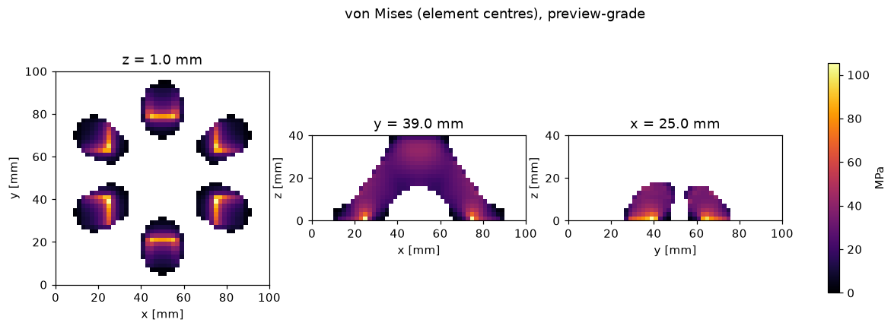
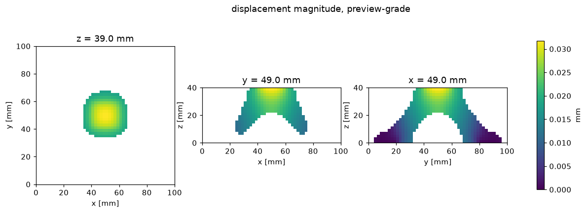

### case x001 · preview-grade

| quantity | value |
|---|---|
| mass_kg | 0.176986 |
| mesh_volume_mm3 | 66286.8 |
| voxel_volume_mm3 | 67152 |
| compliance_Nmm | 864.846 |
| umax_mm | 0.032483 |
| vm_p99_MPa | 56.8794 |
| vm_p95_MPa | 40.9739 |
| vm_max_MPa | 105.392 |
| pcg_iters | 443 |
| pcg_relres | 9.80244e-09 |
| elements | 50000 |
| elem_mm | 2 |

Geometry `part.stl`: organic skin (marching cubes of an implicit field), mesh volume 66286.8 mm³; mass 0.176986 kg from the mesh volume. Voxelised at 2 mm into 8394 solid cells of 50000 (voxel/mesh volume 1.0131).

Solve: NVIDIA CMP 170HX float64 on lane rig-gpu, 443 PCG iterations, true relative residual 9.80e-09, converged. Constrained stress is vm_p99 over the solid elements outside the boundary-condition zones (+-8 mm); vm_max is recorded but is resolution-sensitive.

preview-grade: a voxel solve on the rig is evidence, not sign-off.

